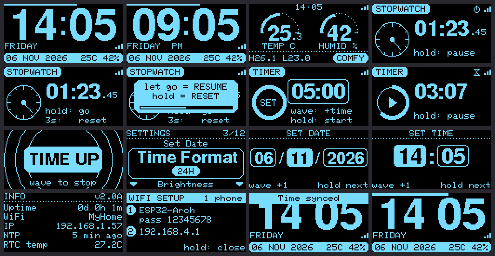
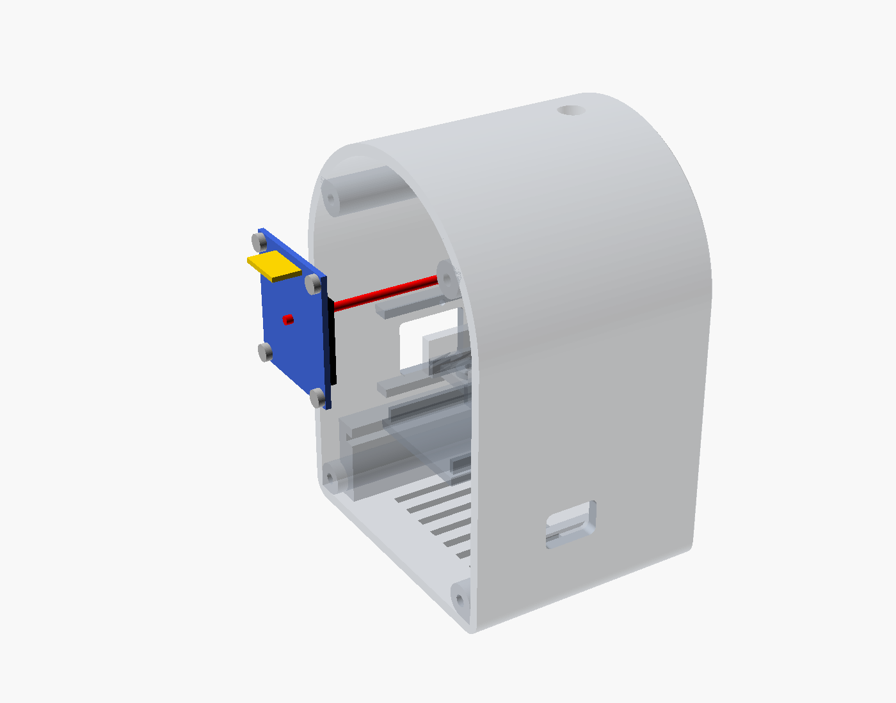
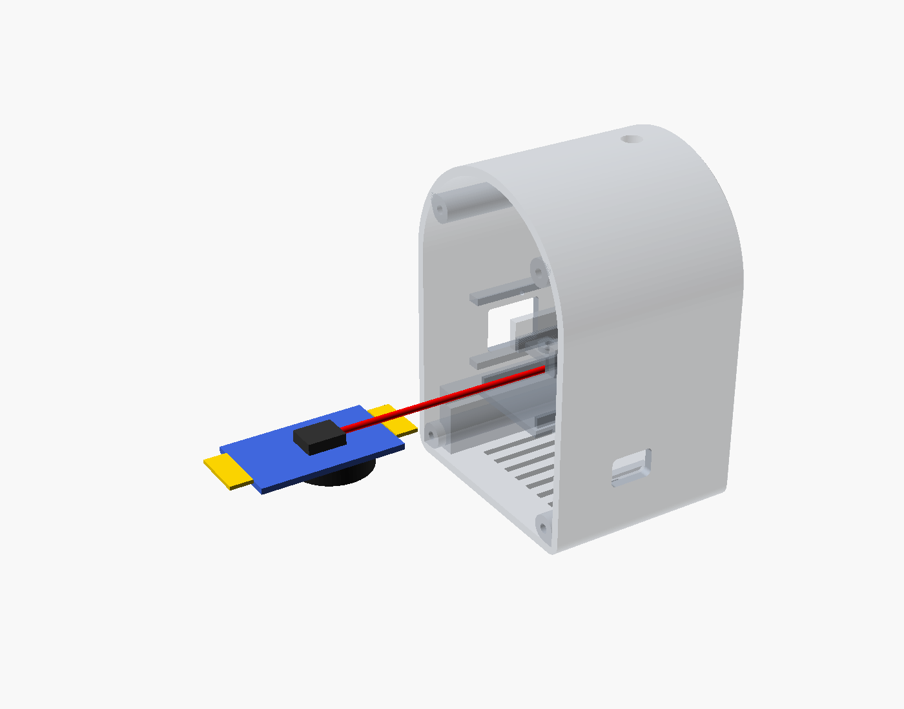
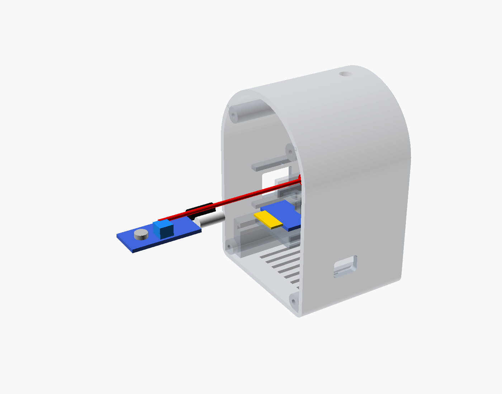
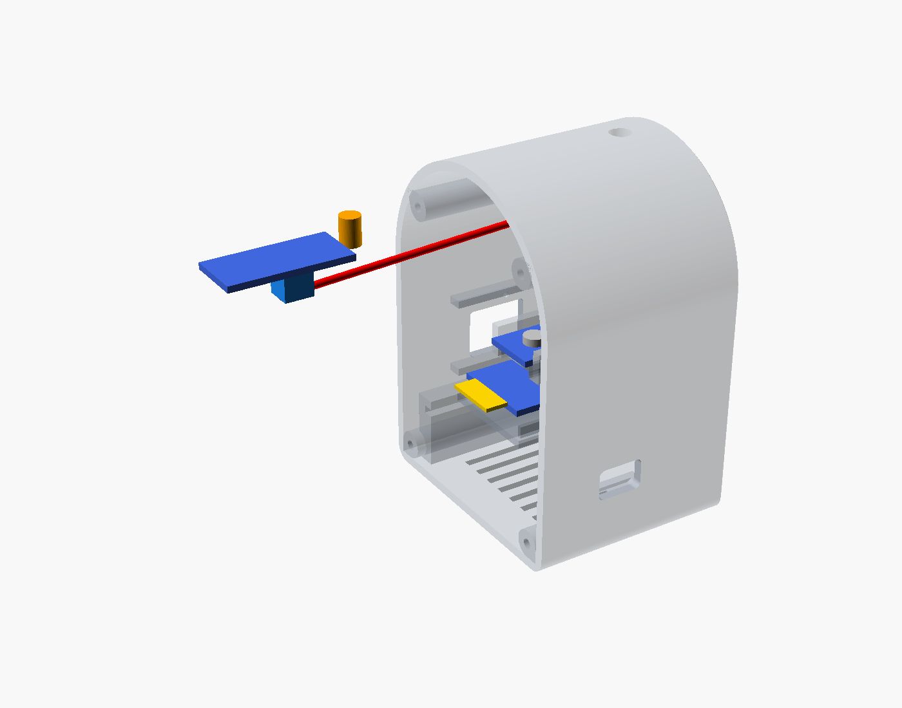
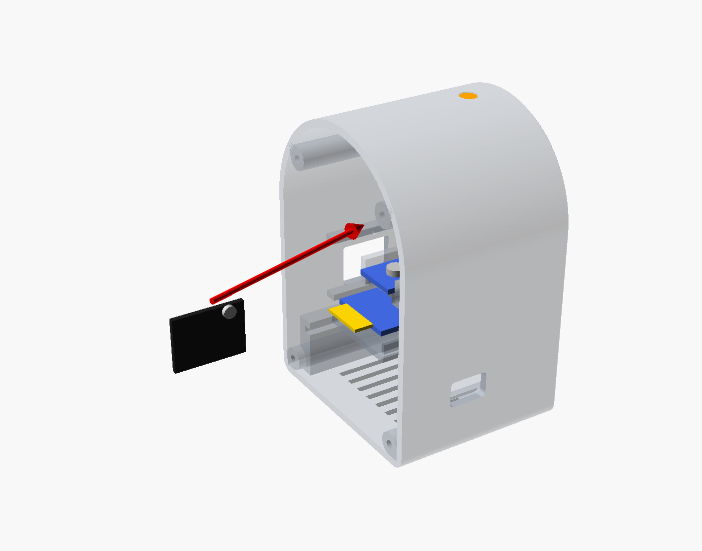
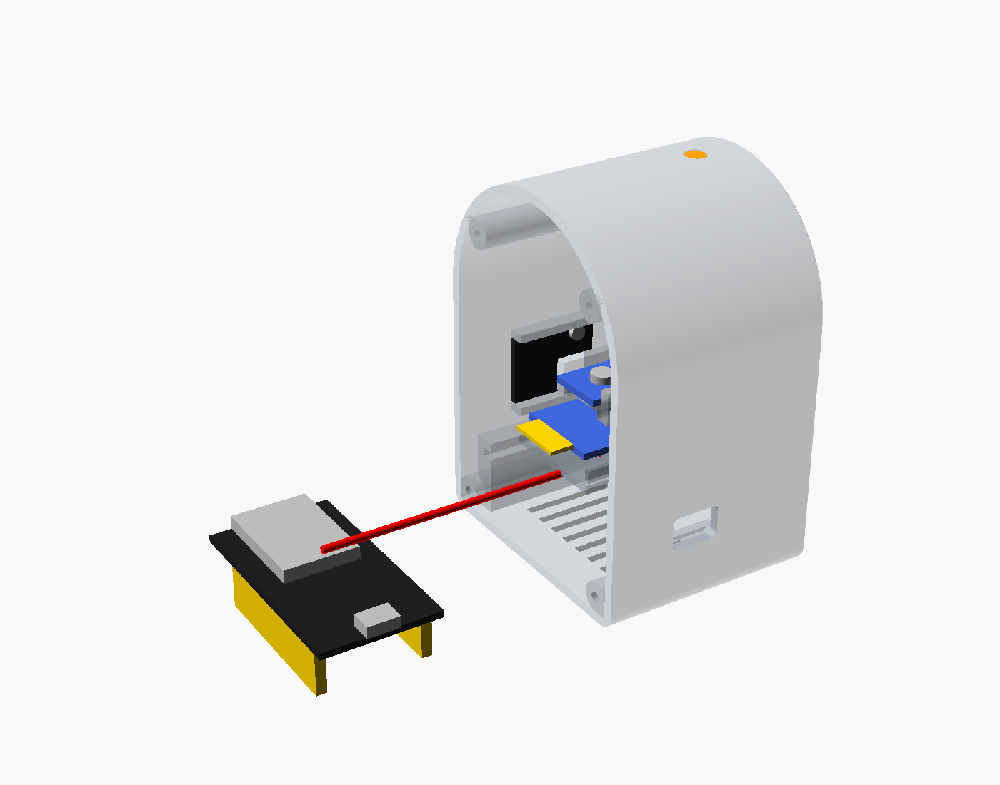
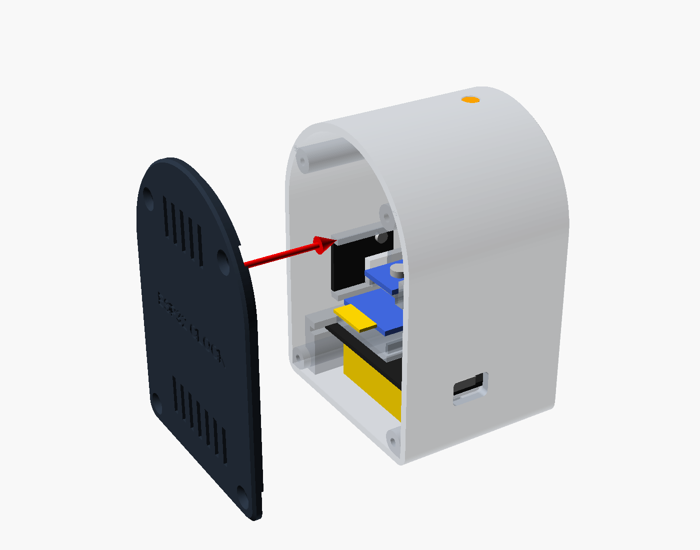
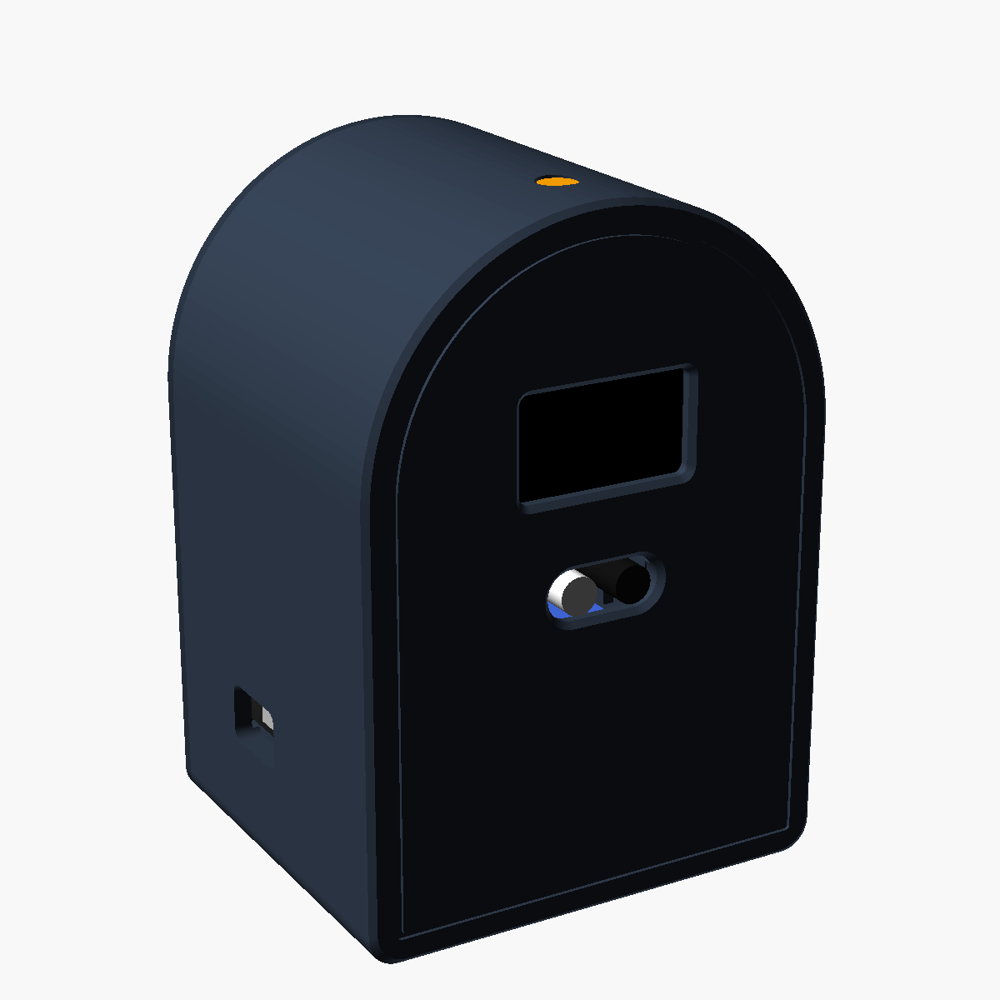

# ESP32 Arch Clock

นาฬิกาตั้งโต๊ะ ESP32 ทรงหัวโค้ง — จอ OLED, เซนเซอร์แสง, อุณหภูมิ/ความชื้น, ควบคุมด้วยการโบกมือ (IR) — มีไฟล์กล่องสำหรับพิมพ์ 3D และรูปขั้นตอนประกอบ

เป็นเวอร์ชันที่ 2 ของ [ESP32_Clock](https://github.com/poko56/ESP32_Clock): ฟังก์ชันเหมือนกัน แต่หน้าจอ (UI) ออกแบบใหม่ทั้งหมด และใช้กล่องทรงตั้งหัวโค้ง

| กล่อง | หน้าจอทั้งหมด |
|---|---|
|  |  |

## อุปกรณ์

| อุปกรณ์ | หน้าที่ |
|---|---|
| ESP32 DevKit (30 ขา) | ตัวควบคุม + WiFi |
| OLED 0.96" I2C (SSD1306) | จอแสดงผล |
| DS3231 | นาฬิกาเวลาจริง (เดินต่อแม้ถอดไฟ) |
| FC-51 IR | ควบคุมด้วยการโบกมือ |
| LDR module | ปรับความสว่างจอ / ดับจอตอนมืด |
| DHT11 module | อุณหภูมิ + ความชื้น |

## การต่อสาย

| อุปกรณ์ | ขา | ESP32 |
|---|---|---|
| OLED / DS3231 | SDA | GPIO 21 |
| OLED / DS3231 | SCL (SCK) | GPIO 22 |
| OLED / DS3231 | VCC / GND | 3V3 / GND |
| LDR | AO | GPIO 34 |
| IR | OUT | GPIO 27 |
| DHT11 | DATA | GPIO 4 |
| (ปุ่ม BOOT บนบอร์ด) | — | GPIO 0 ใช้แทนการโบกมือได้ |

## ติดตั้งโค้ด

ไลบรารี (Arduino Library Manager): `Adafruit SSD1306`, `Adafruit GFX Library`, `RTClib`, `DHT sensor library`, `Adafruit Unified Sensor`

บอร์ด: **ESP32 Dev Module** — เปิด `firmware/ESP32_Clock_Arch/ESP32_Clock_Arch.ino` แล้วอัปโหลด

```bash
arduino-cli compile --upload -p /dev/cu.usbserial-0001 --fqbn esp32:esp32:esp32 firmware/ESP32_Clock_Arch
```

## หน้าจอ (UI แบบ Arch)

- **นาฬิกา:** ตัวเลข 24pt เต็มจอ, เส้นวินาทีวิ่งด้านบน, แถบล่างแสดงวันที่ + อุณหภูมิ
- **อุณหภูมิ/ความชื้น:** เกจครึ่งวงกลม 2 อัน
- **จับเวลา:** หน้าปัดเข็มวินาที + ตัวเลข
- **นับถอยหลัง:** วงแหวนเวลาที่เหลือ + ตัวเลข
- **เมนูตั้งค่า:** แสดงทีละรายการแบบหมุน

## การควบคุม (โบกมือที่ IR หรือกดปุ่ม BOOT)

| ท่า | ผล |
|---|---|
| โบกสั้น | ถัดไป / +1 |
| ค้างมือ 0.7 วิ | ตกลง / เริ่ม-หยุด (ทำงานทันที) |
| ค้างต่อจนครบ 3 วิ | รีเซ็ต (หน้าจับเวลา/นับถอยหลัง) |

ค้างมือที่หน้านาฬิกาเพื่อเข้าเมนูตั้งค่า

## WiFi และการตั้งค่าผ่านมือถือ

- ยังไม่ได้ตั้ง WiFi หรือต่อ WiFi บ้านไม่ได้ภายใน 30 วิ → นาฬิกาเปิด WiFi **`ESP32-Arch`** (รหัส `12345678`) ให้เอง
- ต่อมือถือแล้วเปิด `http://192.168.4.1` → ตั้งเวลาจากมือถือ, ใส่ WiFi บ้าน (2.4 GHz), ตั้งค่าอื่นๆ
- ต่อ WiFi บ้านได้แล้ว นาฬิกาจะดึงเวลาจาก NTP เองทุกชั่วโมง ถ้าเน็ตหลุดก็เดินต่อจาก DS3231

## กล่อง (3D print)

| ไฟล์ | วางพิมพ์ |
|---|---|
| `arch_body_print.stl` | ด้านหน้าคว่ำลงฐาน ไม่ต้องใช้ support |
| `arch_cover_print.stl` | ด้านนอกคว่ำลง |
| `clock_case_arch.scad` | ต้นฉบับ OpenSCAD (แก้ขนาดได้ที่ส่วนบนของไฟล์) |
| `arch_assembly_steps.scad` | ใช้สร้างรูปขั้นตอนประกอบ |

ขนาดภายนอก 64.8 × 56.5 × 90.8 มม.

น็อตเกลียวปล่อย: M3×10 ×4 (ฝาหลัง), M3×6 ×2 (IR, LDR), M2×4 ×5 (OLED 4, DHT11 1)

## ขั้นตอนประกอบ

รูปอยู่ในโฟลเดอร์ [`assembly_steps/`](assembly_steps) — ใส่ตามลำดับ:

1. OLED (M2×4 ×4) → 2. DS3231 (เทปกาวสองหน้าบนชั้นวาง) → 3. IR (M3×6) → 4. LDR (คว่ำโมดูล ดัดหัวขึ้นรูปบนยอด, M3×6) → 5. DHT11 (M2×4) → 6. ESP32 (สอดปลายเสาอากาศเข้าร่อง) → 7. ฝาหลัง (M3×10 ×4)

| | | | |
|---|---|---|---|
|  |  |  |  |
|  |  |  |  |

ตำแหน่งรูน็อตของเซนเซอร์วัดจากรูปถ่าย (±0.5 มม.) — ถ้าไม่ตรงใช้กาวร้อนแทนได้
